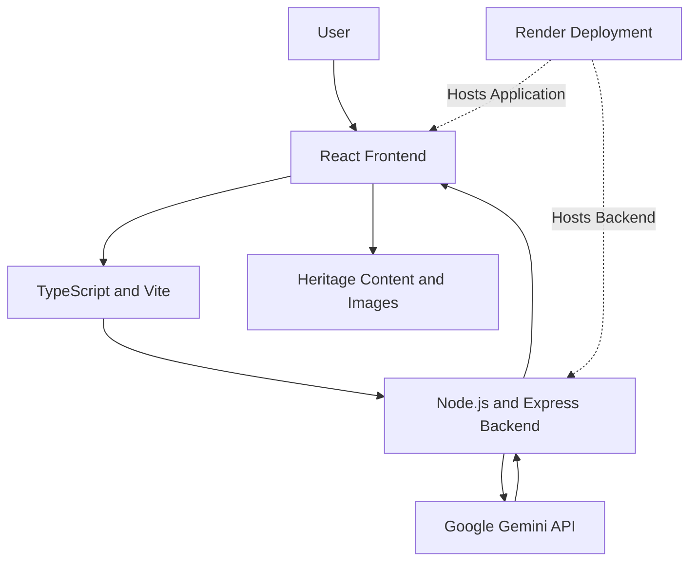
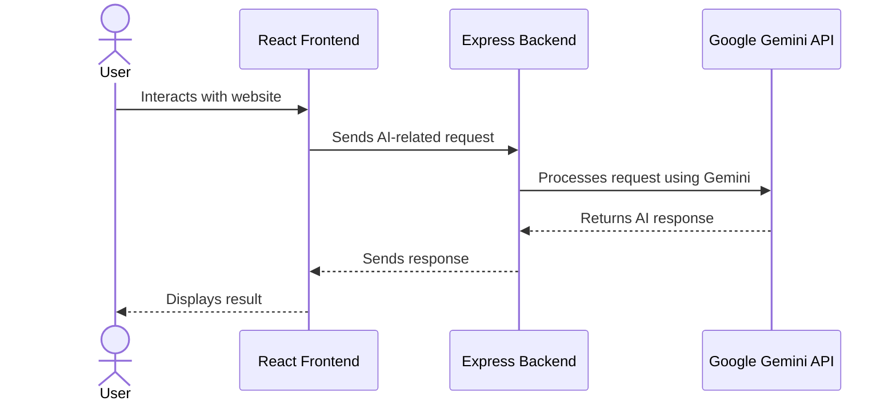
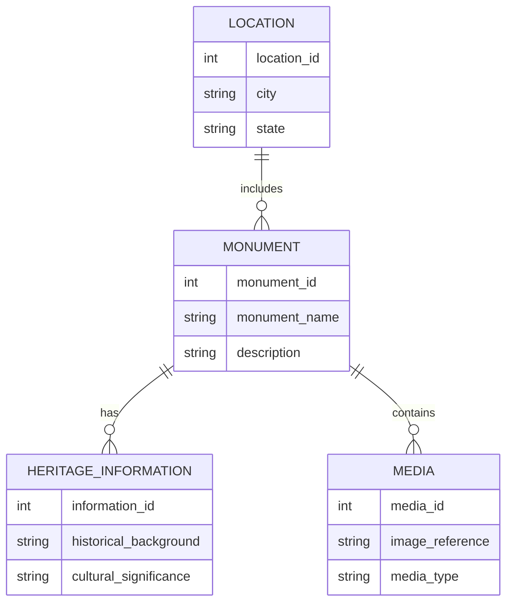

# Sanskriti – Digital Revitalisation of India's Cultural & Architectural Heritage

Sanskriti is a digital heritage platform designed to make India's rich cultural and architectural heritage easier to discover, explore, and understand.

The platform brings historical monuments, cultural information, and heritage stories together through an interactive web experience, with AI-powered assistance to support heritage exploration.

## Live Demo

https://sanskriti-digital-heritage.onrender.com

## Problem Statement

Digital Revitalisation of Unstructured Cultural & Architectural Heritage Archives

India has a vast collection of historical monuments, cultural traditions, and architectural heritage. However, heritage information can be scattered across different sources, making it difficult for people to discover and understand it in one place.

Sanskriti aims to make heritage exploration more accessible through a unified digital platform.

## Our Solution

Sanskriti provides an interactive platform where users can explore India's cultural and architectural heritage.

It aims to:
- Make heritage information easier to discover.
- Present monument-related information in an accessible format.
- Encourage awareness of India's history and culture.
- Use AI-powered assistance to support heritage exploration.

## Key Features

- Interactive heritage exploration website.
- Cultural and historical information about Indian heritage.
- Monument-focused content and visual presentation.
- AI-powered heritage assistance.
- User-friendly and responsive interface.

## System Architecture

The following diagram illustrates the high-level architecture of Sanskriti.

### Architecture Components

1. Frontend: React.js and TypeScript provide the user interface.
2. Build Tool: Vite supports frontend development and building.
3. Backend: Node.js and Express.js handle application requests.
4. AI Integration: Google Gemini API supports AI-powered functionality.
5. Deployment: Render hosts the deployed application.

## Application Request Flow

This flow represents the AI-assisted request process at a high level.

## Conceptual Data Model

The following diagram represents a proposed way to organize heritage information. It is a conceptual model, not an implemented database schema.

### Conceptual Data Entities

- Monument: Monument name and description.
- Location: City and state associated with a monument.
- Heritage Information: Historical background and cultural significance.
- Media: Images and related visual references.

## Technology Stack

| Layer | Technology |
|---|---|
| Frontend | React.js, TypeScript |
| Build Tool | Vite |
| Backend | Node.js, Express.js |
| AI Integration | Google Gemini API |
| Deployment | Render |
| Version Control | GitHub |

## Value and Potential Scalability

- Helps improve digital access to heritage information.
- Can support students, tourists, researchers, and heritage enthusiasts.
- Can be expanded to include more monuments and regions.
- Can support multilingual heritage content in the future.
- Has potential for collaboration with educational and cultural organizations.

## Limitations

- Heritage information coverage may currently be limited.
- AI-generated responses should be verified for historical accuracy.
- The platform depends on internet connectivity.
- A structured, verified heritage database can be developed further.

## Future Roadmap

- Expand the monument and heritage information collection.
- Add regional language support.
- Introduce advanced search and filtering.
- Improve AI-powered heritage assistance.
- Explore interactive maps and virtual heritage experiences.
- Develop a verified and structured heritage database.

## Team – Coderpath

1. Kriya Shah
2. Meet Modi
3. Vidhi Vyas

## Hackathon Information

- Event: Blithchron '27
- Organization: IIT Gandhinagar
- Domain: Culture, Media & Entertainment
- Project Type: Software / Open Innovation

## Repository

https://github.com/kriyashah713-code/sanskriti-digital-heritage

## Our Vision

Explore the past. Understand our heritage. Preserve it for the future.
